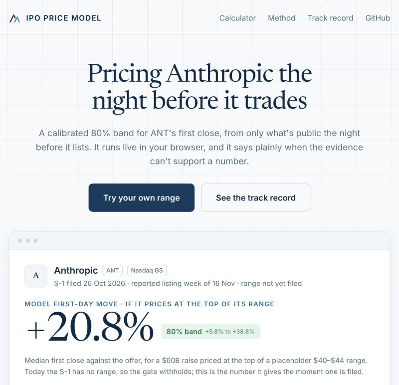

# ipo-price-model

[](https://github.com/henryzhangpku/ipo-price-model/actions/workflows/ci.yml)
[](https://github.com/henryzhangpku/ipo-price-model/actions/workflows/track.yml)
[](https://henryzhangpku.github.io/ipo-price-model/)
[](LICENSE)

**Price a company the day before it trades, and know when not to.**

The night before a listing opens, the public record is thin: an offer price, a
filed range, a deal size, an exchange, and what the last few listings did. This
model turns exactly that into a calibrated 80% interval for the first close,
plus a gate that **withholds the number** when the evidence cannot carry one.
The refusals are the product.

[](https://henryzhangpku.github.io/ipo-price-model/)

**[Live demo →](https://henryzhangpku.github.io/ipo-price-model/)** Anthropic
(Nasdaq: ANT), tracked from its S-1 to its first close. The fitted model runs
tree by tree in your browser: enter a range and an offer, and the gate decides.

## Live: ANT, tracked to its first trade

A scheduled GitHub Action ([`track.yml`](.github/workflows/track.yml), weekday
mornings and pricing nights) runs the test suite, then `ipo-price-model track`:

| input | source | what changes on the page |
|---|---|---|
| the filing | Anthropic's latest registration cover and final prospectus on EDGAR | the placeholder range becomes the filed range; on pricing night, the actual call |
| the regime | newly priced listings from the public Nasdaq IPO calendar, with first closes, filtered and labelled by the training cohort's rules | the 90-day market read behind every band |
| the result | the first close after the first trade | the band published beforehand is scored: inside or outside |

The model itself is **frozen**. It is never refitted during the test, and the
SHA-256 of [`docs/model.json`](docs/model.json) is written into every record, so
the model that scores the first close is provably the one published on day one.

Every change is appended to [`tracker/tape.jsonl`](tracker/tape.jsonl) and
committed by the job. A record is never edited (a later one supersedes it), each
says what went wrong if anything did, and the commit history is the audit trail.
An outage never moves the record backwards: a failed EDGAR read keeps the last
filing and says so.

```bash
ipo-price-model track --deal tracker/ant.json            # what the job runs
ipo-price-model track --deal tracker/ant.json --offline  # no network: committed files only
```

## How it prices

```
$ ipo-price-model price --date 2025-11-14 --offer 21 --low 18 --high 20 --deal 450e6
{
  "offer": 21.0,
  "point": 29.53,
  "lo": 23.47,
  "hi": 29.85,
  "nominal_coverage": 0.8,
  "published": true,
  "reason": null,
  "regime_n": 48
}

$ ipo-price-model price --date 2025-11-14 --offer 21 --deal 450e6            # no filed range
{ ..., "published": false, "reason": "no_range" }

$ ipo-price-model price --date 2025-11-14 --offer 4 --low 4 --high 5 --deal 8e6 --exchange "NASDAQ Capital"
{ "point": 4.05, "lo": 2.64, "hi": 5.77, ..., "published": false, "reason": "too_wide" }
```

Real output from the model fitted on the data frozen on 1 November 2026
(listings from 2019 to 14 November 2026; prices rounded to cents). A $450M deal
that priced above its range gets a band. The same deal with no filed range is
withheld. An $8M micro-cap gets a band too wide to be useful, and the gate says
so instead of printing a midpoint.

## Results

Second full run, 1 November 2026. Train on listings to 2022, calibrate on
2023, test from 2024 to the last first close in the data (23 October 2026).
Nominal coverage 80%. The first run (30 September, test window to 2025) is in
the git history; its data was not kept, so this run rebuilt everything from the
sources.

| test window, 2024 onward | listings | coverage | mean width, × offer |
|---|---|---|---|
| model, every listing | 428 | 0.836 | 1.37 |
| reference, every listing | 428 | 0.811 | 0.67 |
| **model, the 103 the gate publishes** | 103 | **0.680** | **0.50** |
| reference, the same 103 | 103 | 0.777 | 0.67 |
| model, deals of $500M or more | 61 | 0.754 | 0.55 |

**The verdict, by the rule fixed before the run: the reference stands.**
Across every listing the fitted model's interval is twice as wide, because
micro-cap listings (under $50M, 47% of the test window) have first days the
deal facts cannot predict. The point estimate is barely better than the offer
price (mean absolute error 22.6% vs 23.6% of the offer).

**What the gate does with that.** It withholds 325 of 428: 240 as
`too_wide`, almost all micro-caps, and 85 as `no_range`. The first run's
post-hoc finding, that the published band is narrower than the reference's at
the same coverage, **did not replicate**. On the 103 it publishes the band is
still a quarter narrower, but it covers only 68% against the 80% target (the
reference covers 78%). By year, model coverage over all listings went 0.89 in
2024, 0.83 in 2025 and 0.77 in 2026, so the 2023 calibration window is going
stale. The next version makes the published subset the preregistered scoring
rule and recalibrates on a rolling window.

The demo's model is the same method refitted on more recent data: trained
through 2023 and calibrated on 2024 to October 2026. The table above scores the
method; the ANT numbers come from the refit.

Three data facts behind those numbers, each found by running it:

- **Filed ranges come from EDGAR, not the calendar.** The public calendar
  keeps none. 1,171 of 1,486 core listings (79%) carry a range read from the
  last S-1/A or F-1/A cover filed before the first trade.
- **First closes are restored from split-adjusted history.** A listing with a
  later split has its first close multiplied back by every split ratio since;
  without that, a 1-for-10 reverse split shows a first close ten times too high.
- **1,041 listings have a usable first close.** The rest are delisted from the
  free price source, or fail the declared validity bounds (first print more
  than a week after listing, or a first close outside 0.1×–30× the offer,
  which in practice means a reused ticker).

## Why this exists

Pricing something that does not trade yet is the same problem everywhere it
appears: few observations, stale ones, selection toward the deals that
happened, and a large gap between a transaction and a valuation. I built two
settlement-grade benchmarks for markets like that ([GPU compute](https://github.com/henryzhangpku/gpu-price-index),
[LLM tokens](https://github.com/henryzhangpku/token-price-index)), and the
part that mattered in both was not the estimator. It was the publication
gate: deciding when the evidence is too thin to print, and defending the
refusal.

An IPO the night before it opens is the cleanest public instance of that
problem, with a label that arrives the next afternoon. So it is a good place
to show the whole discipline in one small repo: T-1 features only, leakage
assertions that raise, a chronological fit, a distribution-free interval, a
reference the model has to beat, a gate that says no, and a live test scored
in public.

## What it does

| step | what | where |
|---|---|---|
| **universe** | every priced US listing from 2019 in the public IPO calendar, SPACs and units tagged as cohorts | `universe.py` |
| **ranges** | the filed range, read from the cover of the last S-1/A filed on EDGAR before the first trade (the calendar keeps none) | `filings.py` |
| **labels** | first close, first-day move, 30-session return, computed so T-1 can never see them | `labels.py` |
| **features** | deal facts + a trailing regime built only from listings that closed *strictly before* T-1 | `features.py` |
| **model** | gradient-boosted quantiles, then split-conformal calibration on a later window (CQR) | `model.py` |
| **reference** | offer price ± the calibration window's empirical quantiles; the bar to clear | `model.py` |
| **gate** | `no_range` → `thin_regime` → `too_wide`; declared thresholds, audited refusals | `gate.py` |
| **evaluate** | coverage and width, overall / by year / by deal size, published vs withheld, JSON either way | `evaluate.py` |
| **export** | the fitted trees, conformal shift and test vectors, for the browser | `docs/export_model.py` |
| **track** | one live deal to its first trade with the frozen model; an append-only record | `tracker.py` |

Full reasoning, including what is deliberately left out: [METHODOLOGY.md](METHODOLOGY.md).

## Run it

```bash
uv sync --extra dev                    # or: pip install -e ".[dev]"
export FINNHUB_API_KEY=...             # free tier is enough for the calendar
export SEC_USER_AGENT="your-name your@email"   # EDGAR asks for a contact
uv run ipo-price-model universe --from 2019-01-01 --to 2026-11-14
uv run ipo-price-model ranges          # EDGAR, cached and resumable
uv run ipo-price-model labels          # throttled and resumable; re-run if rate-limited
uv run ipo-price-model evaluate        # train ≤2022, calibrate 2023, test 2024→
uv run ipo-price-model price --date 2026-10-14 --offer 21 --low 18 --high 20 --deal 450e6
uv run python docs/export_model.py --date 2026-11-16   # refit and export the demo's model
uv run pytest -q                       # 29 tests, no network, no keys
```

## What the tests pin down

- a feature column that is not on the declared T-1 list raises
- a regime that includes a listing on or after the decision date raises
- a label dated on or before the decision raises
- a filed range from an amendment dated on or after the first trade raises
- the range parser reads both cover phrasings and rejects fixed prices, inverted and implausible ranges
- splits that are not train < calibrate < test raise
- conformal coverage holds on a held-out window of synthetic data
- the gate's reasons fire in the declared order and never touch the interval
- the frozen model in `docs/model.json` reproduces the fitted model on every test vector
- the share count is read only from the cover's offering sentence, never from elsewhere in a prospectus
- the record only grows: a rerun with nothing new appends nothing, and an EDGAR outage carries the last filing forward

## Honest limits

The public calendar keeps no filed ranges, so ranges are read from EDGAR
registration covers filed before the first trade. Deals whose cover states a
fixed price, and deals the parser cannot read, are withheld as `no_range`, and
the share withheld is reported, not hidden. Labels come from a free price
source, so listings that have since delisted can lack a first close; that
biases the sample toward survivors, and the count dropped is reported. No
underwriter identity, no sector, no S-1 text: each would be a new declared
feature with its own preregistration.

For ANT specifically: the largest IPO with a filed range in the data is Rivian
at $12B, and a $60–100B raise is five to eight times that (the largest listing
of any kind is Coinbase's $29B direct listing, with no range: two to three and
a half times). Gradient-boosted trees do not extrapolate, so above about $5B
the deal size changes nothing, and the band describes how the very largest past
listings behaved, not a forecast for a deal the US market has never priced.
Two public inputs still move the frozen model's answer: the filed range (its
width as well as where the offer lands) and the 90-day IPO market. The market
read rests on a dozen or so listings, and the trees respond to it in steps, so
one new listing can move the band; every such move is in the record. Until the cover states
a share count, the deal size is a press estimate, labelled as one. The live
regime adds listings from the Nasdaq calendar, while the frozen data came from
Finnhub; both go through the same cohort rules.

The first-day move is not presented as an investable return. Research tooling;
nothing here is investment advice. Not affiliated with Anthropic.

MIT.

---

## Author

**Henry Zhang**: quantitative engineer; fifteen years building research platforms and production trading systems, including eight years at BlackRock and two at PIMCO.

[LinkedIn](https://www.linkedin.com/in/henryzhang99/) · [GitHub](https://github.com/henryzhangpku) · [Substack](https://henryzhang.substack.com) · [officialhenryzhang.com](https://www.officialhenryzhang.com)

More work: [Autonomous Quant Researcher](https://github.com/henryzhangpku/autonomous-quant-researcher) (an LLM proposes, trusted code decides) · [research2prod](https://github.com/henryzhangpku/research2prod) (research code that is already production code) · [mft-engine](https://github.com/henryzhangpku/mft-engine) (one Rust code path for backtest and live) · [GPU price index](https://github.com/henryzhangpku/gpu-price-index) (a daily benchmark built like a settlement index) · [all repositories](https://github.com/henryzhangpku?tab=repositories)
